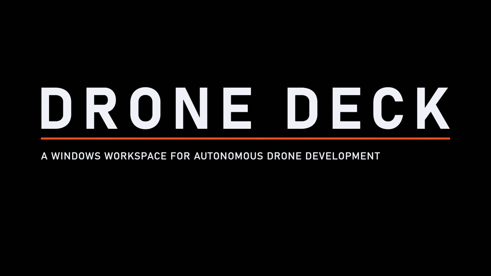

# Drone Deck

A Windows desktop workspace for autonomous drone development, built with the Rune UI framework. Drone Deck connects simulation, vehicle telemetry, ROS 2, recordings, models and inference workflows in one place.

## Watch Drone Deck

[](media/drone-deck-demo.mp4)

[Watch the full video](media/drone-deck-demo.mp4) · 59 seconds

Repository: [muhammadumair11/drone-deck](https://github.com/muhammadumair11/drone-deck).

**Early public preview.** Expect rough edges and integration gaps. Drone Deck is open for community evaluation and contribution; clean-machine setup and real-hardware workflows still need validation. Read [Known issues](drone-deck/docs/known-issues.md) before relying on a workflow.

## What you can work with

- PX4 SIH, PX4 + Gazebo and ArduPilot SITL launch profiles.
- WSL/tool preparation, staged sessions, process output and diagnostics.
- MAVLink telemetry, simulation flight actions and read tools for physical vehicles.
- ROS 2 recordings with rosbag2/MCAP, Hugging Face model access and offline inference workflows.
- Custom tool profiles, shared PX4 locations, themes and zoom.

Capabilities have different validation levels; an integration being present does not establish end-to-end verification.

## Contributions

See [CONTRIBUTING.md](CONTRIBUTING.md) for development, tests and pull requests. Reproducible bug reports, Windows/WSL setup validation, documentation and integration testing are useful starting points. Security concerns belong through [SECURITY.md](SECURITY.md).

## Install and run

Download `DroneDeck-<version>-setup.exe` from [Releases](https://github.com/muhammadumair11/drone-deck/releases). The per-user installer provides a Start menu shortcut and an uninstaller; user data stays under `%LOCALAPPDATA%\DroneDeck`. The installer and executable are currently unsigned.

The ZIP is a portable program package: keep `Drone Deck.exe`, `runtime/` and `assets/` together. Application data still uses LocalAppData unless portable mode is explicitly enabled.

Linux flight tools run in WSL 2, with Ubuntu 24.04 as the initial supported environment. Guided setup detects existing tools and reviews missing prerequisites before installation.

## Build from source

Use Windows 10/11 x64, the Rust toolchain pinned in `rust-toolchain.toml`, and Microsoft C++ Build Tools with a Windows SDK. Inno Setup 6.3 or newer is needed for the setup executable.

```powershell
git clone https://github.com/muhammadumair11/drone-deck.git "Drone Deck"
cd "Drone Deck"
cargo test --locked --manifest-path drone-deck/Cargo.toml
drone-deck\Build.ps1 -Installer
```

The build creates a local executable and `dist/DroneDeck-<version>/`, ZIP and installer outputs. Version tags matching the manifest trigger the release workflow after its checks pass.

## Documentation

- [Application README](drone-deck/README.md)
- [User guide](drone-deck/docs/user-guide.md)
- [Known issues and validation limits](drone-deck/docs/known-issues.md)
- [Architecture](drone-deck/docs/architecture.md)
- [Release packaging](drone-deck/docs/release.md)
- [Changelog](drone-deck/CHANGELOG.md)

Flight commands inside Drone Deck are restricted to app-owned simulations. Physical connections support monitoring and read tools; an enabled QGroundControl/scripts bridge can forward those programs' commands to the vehicle. Real-environment acceptance remains documented in Known issues.

Drone Deck has been developed with AI-assisted coding and iterative review/testing. The bundled Rune framework retains its own identity and licensing. Its original repository introduction is preserved in [RUNE-README.md](RUNE-README.md); the app's pinned framework revision is recorded in [RUNE_REVISION.md](drone-deck/RUNE_REVISION.md).
